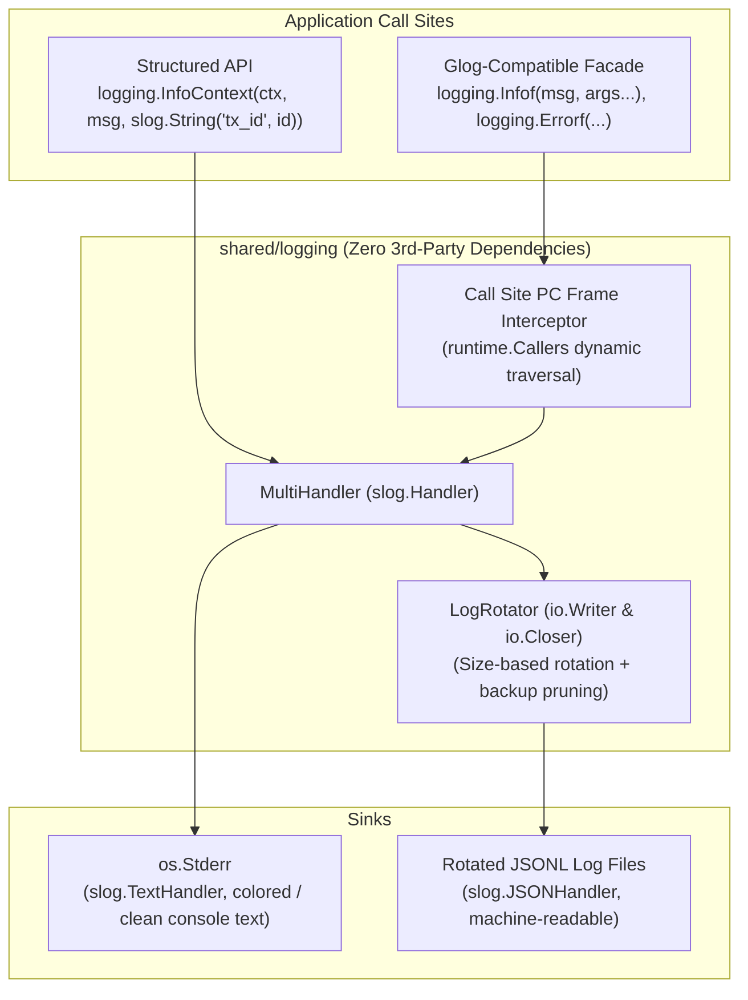

# Specification: Hybrid Structured Logging & Rotation (`shared/logging`)

## 1. Overview
The ONDC Go codebase currently suffers from fragmented and suboptimal logging:
1. Legacy microservices (`buyer-platform`, `seller-platform`, `onboarding`, `key-rotation`, `shared/middleware`) depend on `github.com/golang/glog`, which hijacks `flag.CommandLine`, dumps unbounded, unrotated log files in `/tmp`, and lacks structured JSON formatting.
2. Modern unified binaries (`cmd/ondc-node`, `cmd/ondc-p2p-bridge`) use standard library `"log"`, printing unstructured text to stdout/stderr with no rotation or severity filtering.
3. Edge and self-sovereign nodes deployed in resource-constrained environments (e.g. Raspberry Pis, small cloud VMs) risk disk exhaustion without automatic log file rotation and backup pruning.

This track implements a **Hybrid Structured Logging Pattern** based on [`structured_logging_pattern.md`](/structured_logging_pattern.md) in a new package [`shared/logging`](/shared/logging), delivering:
- Zero external dependencies (pure Go standard library: `log/slog`, `sync`, `os`, `runtime`).
- Thread-safe file `LogRotator` with size-based rotation and backup limit pruning.
- Multiplexed `MultiHandler` emitting human-readable text to `os.Stderr` and structured JSON Lines (JSONL) to rotated log files.
- Program Counter (`pc`) call-site frame preservation via `runtime.Callers` so logs record the actual emitter file and line number.
- First-class structured logging API (`slog.Logger` with attributes and context).
- Drop-in `glog` compatibility facade (`Infof`, `Errorf`, `Warningf`, `V(level)`, `Exitf`) to allow zero-effort migration for existing microservices.
- Handcrafted CLI flags and environment variable resolution for [`cmd/ondc-node`](/cmd/ondc-node) without `spf13`.

---

## 2. Architecture & Design

---

## 3. Functional Requirements

### 3.1 Log Rotator (`shared/logging/rotator.go`)
- Implements `io.Writer` and `io.Closer` with thread safety (`sync.Mutex`).
- Configurable parameters:
  - `dir`: Directory to store log files (auto-created via `os.MkdirAll` if missing).
  - `filename`: Base log file name (e.g., `ondc-node.jsonl`).
  - `maxSizeMB`: File size threshold in megabytes before triggering rotation.
  - `maxBackups`: Maximum number of rotated backup files to retain; older backups are automatically pruned based on modification time.
- Rotated backup file naming convention: `<base>.<YYYYMMDD-HHMMSS><ext>`.

### 3.2 Multiplexed Handler (`shared/logging/handler.go`)
- Implements `slog.Handler`.
- Manages an array of downstream handlers (e.g., `slog.TextHandler` on `os.Stderr` and `slog.JSONHandler` on `LogRotator`).
- Implements `Enabled`, `Handle`, `WithAttrs`, and `WithGroup` propagating to active downstream handlers.

### 3.3 Hybrid Logger & Caller PC Preservation (`shared/logging/logger.go`)
- Exposes `Init(cfg Config) (*slog.Logger, error)` and sets `slog.SetDefault(logger)`.
- Traverses call stack using `runtime.Callers` and `runtime.CallersFrames` to locate the emitter's true call-site PC, excluding helper frames within `shared/logging` and standard library runtime.
- Emits records with `AddSource: true` in the JSON handler so file paths and line numbers accurately match the real caller.

### 3.4 `glog` Drop-in Compatibility Facade (`shared/logging/compat.go`)
- Package-level functions allowing seamless migration of legacy microservices:
  - `Infof(format string, args ...any)`
  - `Errorf(format string, args ...any)`
  - `Warningf(format string, args ...any)`
  - `Exit(args ...any)` / `Exitf(format string, args ...any)`
  - `V(level int) Verbose` with `.Info(...)`, `.Infof(...)`
- Delegates directly to the underlying `slog.Logger` with caller PC frame recovery.

### 3.5 Unified CLI & Node Integration
- Add logging configuration to [`shared/node/config.go`](/shared/node/config.go):
  - `--log-dir` / `ONDC_LOG_DIR` (default: `./data/logs`)
  - `--log-level` / `ONDC_LOG_LEVEL` (default: `INFO`)
  - `--log-max-size` / `ONDC_LOG_MAX_SIZE_MB` (default: `100`)
  - `--log-max-backups` / `ONDC_LOG_MAX_BACKUPS` (default: `5`)
  - `--log-console` / `ONDC_LOG_CONSOLE` (default: `true`)
  - `--log-file` / `ONDC_LOG_FILE` (default: `true`)
- Initialize `shared/logging` in [`cmd/ondc-node/main.go`](/cmd/ondc-node/main.go) and [`cmd/ondc-p2p-bridge/main.go`](/cmd/ondc-p2p-bridge/main.go).
- Replace `glog` import in [`shared/middleware/middleware.go`](/shared/middleware/middleware.go).

---

## 4. Verification & Testing Strategy
1. **Rotator Unit Tests (`shared/logging/rotator_test.go`):**
   - Verify size-triggered file rotation.
   - Verify timestamped backup file creation.
   - Verify `maxBackups` pruning (deleting oldest files first).
   - Verify concurrent writes across goroutines.
2. **Handler Unit Tests (`shared/logging/handler_test.go`):**
   - Verify text formatting on stderr and JSONL formatting on file.
   - Verify level filtering (`DEBUG`, `INFO`, `WARN`, `ERROR`).
   - Verify `WithAttrs` and `WithGroup`.
3. **Caller PC Accuracy Tests (`shared/logging/logger_test.go`, `shared/logging/compat_test.go`):**
   - Verify caller filename and line number in JSON record match the exact line of the test calling `Infof` / `Errorf`.
4. **End-to-End Integration Tests (`test/logging_e2e_test.go`):**
   - Launch unified node with file logging enabled, trigger HTTP endpoints (`/healthz`, `/ondc-site-verification.html`), inspect generated JSONL file for proper schema and rotation.
