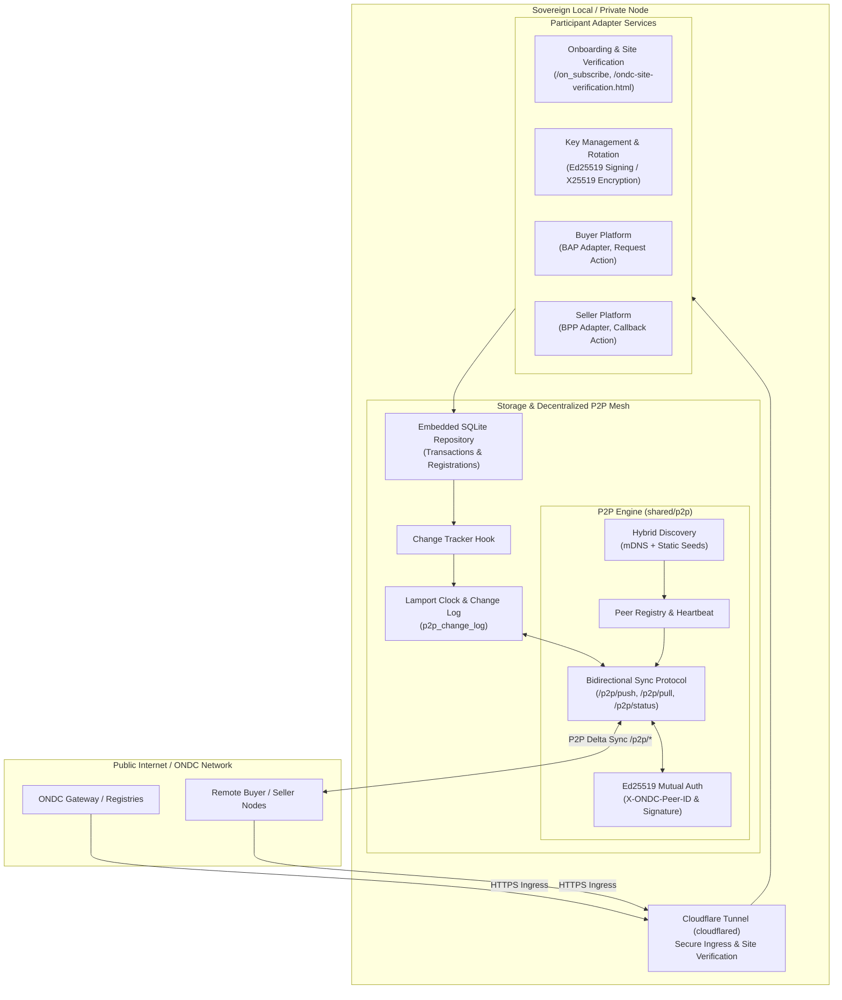
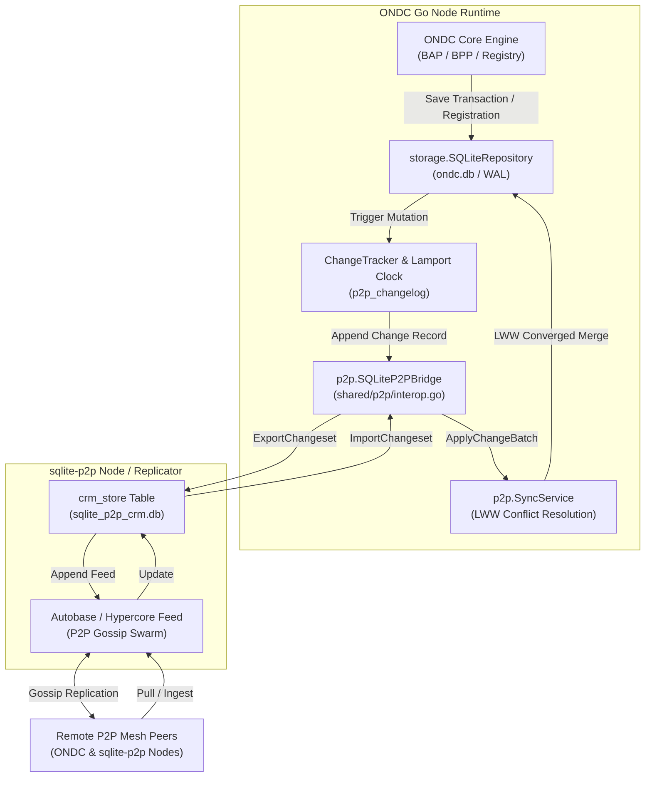
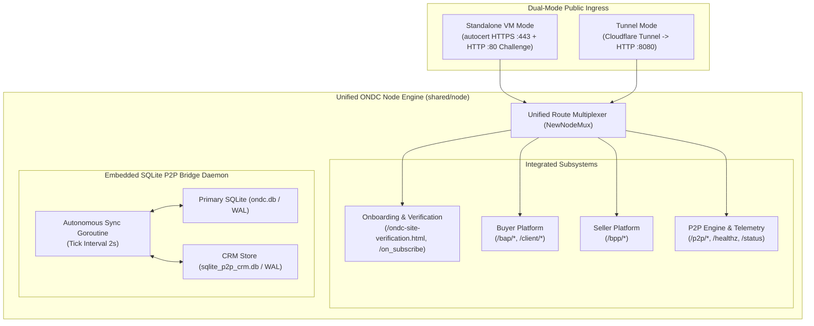

# ONDC Go Architecture

## 1. System Overview

ONDC Go is a sovereign, cloud-agnostic implementation of the Open Network for Digital Commerce (ONDC) participant adapter (Retail Protocol v1.2.0 / OpenAPI v1.0.31). It decouples buyers, sellers, gateways, and registries across the open network through standardized, cryptographically signed HTTP interfaces while eliminating hard dependencies on proprietary cloud infrastructure (e.g. Google Cloud Spanner, Cloud Pub/Sub, Cloud Secret Manager).

### High-Level Architecture Diagram



---

## 2. Core Service Components

1. **Onboarding & Site Verification Service (`/onboarding`):**
   - Implements `/on_subscribe` callback verification and public site verification (`/ondc-site-verification.html`).
   - Generates and signs challenge strings for participant verification against ONDC staging and production registries.

2. **Key Management & Rotation Service (`/key-rotation`):**
   - Manages cryptographic identity: Ed25519 keys for signing/authorization and X25519 keys for payload encryption.
   - Provides key rotation and secure local key storage interfaces.

3. **Buyer Platform (`/buyer-platform`):**
   - BAP (Buyer App Protocol) adapter translating internal buyer e-commerce intents into ONDC retail schema requests (`search`, `init`, `confirm`, `status`, etc.).
   - Asynchronous request-action handlers correlating broadcast responses.

4. **Seller Platform (`/seller-platform`):**
   - BPP (Buyer Protocol Participant) adapter receiving network requests, verifying authorization headers, invoking local catalog/fulfillment systems, and issuing `/on_*` callbacks.

5. **Local Ingress via Cloudflare Tunnel (`/scripts/run_local_tunnel.sh`):**
   - Provides stable public HTTPS hostnames without open inbound firewall ports or public static IPs.
   - Allows local and sovereign deployments to receive callbacks and pass ONDC registry site verification.

---

## 3. Storage & P2P Replication Architecture

### 3.1. Design Objectives
Traditional ONDC adapters rely on centralized cloud managed databases (such as Google Cloud Spanner). In contrast, ONDC Go is engineered to operate on embedded storage with eventual consistency across distributed nodes:
- **Zero Cloud Lock-in:** Operates seamlessly on local bare-metal, containers, edge gateways, or sovereign private clouds.
- **Relational Integrity:** Structured transactional state (order progress, quote confirmations, participant registries).
- **Decentralized Synchronization:** Automatic peer discovery, delta replication, and deterministic conflict resolution across ONDC participant meshes.

---

### 3.2. Pure Go SQLite (`modernc.org/sqlite`) vs `sqlite-p2p`

A key architectural aspect of the storage layer is the relationship between the embedded database driver (`modernc.org/sqlite`) and the [`sqlite-p2p`](https://github.com/innomon/sqlite-p2p) specification.

#### The Driver Relationship
The standalone [`sqlite-p2p`](https://github.com/innomon/sqlite-p2p) library is itself backed by `modernc.org/sqlite` (v1.59.0) to deliver pure-Go, zero-CGO (`CGO_ENABLED=0`) SQLite execution. In `sqlite-p2p`, this driver is paired with Holepunch/Hyperswarm DHT networking and a generic key-value document store (`crm_store`).

In `ondc-go`, the storage engine utilizes `modernc.org/sqlite` directly to manage structured relational SQL tables (`transactions`, `registrations`, `p2p_change_log`) while implementing the P2P discovery and replication protocol natively in [`/shared/p2p`](/shared/p2p).

#### Comprehensive Architectural Comparison

| Dimension | `ondc-go` Current Implementation | Standalone `sqlite-p2p` Engine |
| :--- | :--- | :--- |
| **Underlying SQLite Engine** | `modernc.org/sqlite` (Pure Go, CGO-free) | `modernc.org/sqlite` (Pure Go, CGO-free) |
| **Data Schema** | **Native Relational SQL**: Typed tables (`transactions`, `registrations`), secondary indexes, foreign keys, and atomic SQL transactions. | **Key-Value Document Store**: Single `crm_store` table (`key TEXT PRIMARY KEY`, `metadata TEXT CHECK(json_valid)`, `data BLOB`). |
| **Replication Layer** | Incremental SQL mutation log (`p2p_change_log`) with Lamport logical clock timestamps and push/pull HTTP streaming. | Hypercore append-only feeds and Autobase replication over Hyperswarm connections. |
| **Network Transport** | HTTP REST endpoints (`/p2p/*`) with mutual Ed25519 authentication headers. Native fit for web gateways & Cloudflare Tunnels. | Hyperswarm Kademlia DHT over UDP/UTP with Noise/NOVA SecretStream handshakes. |
| **NAT Traversal** | Handled via Cloudflare Tunnel (`cloudflared`), VPN, or public HTTPS ingress. | Handled via Hyperswarm UDP hole-punching. |
| **Security & Auth** | ONDC Participant Keystore Ed25519 signatures (`X-ONDC-Peer-ID`, `X-ONDC-Signature`, `X-ONDC-Timestamp`). | SecretStream key pairs and swarm topic verification. |
| **Crypto-Shredding** | Host/filesystem-level encryption at rest; direct column payload storage. | Built-in per-record AES-256-GCM envelope encryption with cryptographic key deletion for GDPR/DPDP. |
| **Build & Dependencies** | Hermetic, zero external CGO or local file module replacements. Builds cleanly in standard CI/CD. | Requires local `go-pear` module dependencies. |

---

### 3.3. Fulfillment of Replication Requirements

All P2P synchronization and replication requirements outlined in the technical specification are fully fulfilled by the engine in [`/shared/p2p`](/shared/p2p) and [`/shared/storage`](/shared/storage):

1. **Incremental Delta Synchronization:**
   - Every mutation in [`/shared/storage/sqlite_repository.go`](/shared/storage/sqlite_repository.go) triggers the `storage.ChangeTracker` hook.
   - The [`ChangeLogStore`](/shared/p2p/changelog.go) captures table name, operation (`INSERT`, `UPDATE`, `DELETE`), primary key, and JSON payload along with monotonic logical clocks.

2. **Logical Ordering & Lamport Clocks:**
   - A thread-safe [`LamportClock`](/shared/p2p/changelog.go) guarantees monotonic sequencing across distributed writes.
   - Incoming replication payloads merge the remote clock (`max(local, remote) + 1`), ensuring causal consistency.

3. **Deterministic Conflict Resolution (LWW):**
   - The [`SyncService`](/shared/p2p/sync_service.go) evaluates conflicting record versions using Last-Write-Wins (LWW):
     1. Highest Lamport clock wins.
     2. Lexicographical Node ID tie-breaker guarantees identical convergence across all nodes without split-brain anomalies.

4. **Bidirectional Delta Replication:**
   - Push endpoint (`/p2p/push`) allows nodes to actively stream change batches to known peers.
   - Pull endpoint (`/p2p/pull`) supports pagination (`since_clock`, `limit`) for resynchronization following network partitions.

5. **Hybrid Peer Discovery:**
   - Local network discovery uses multicast DNS (mDNS) over IPv4/IPv6.
   - Wide-area discovery probes configured bootstrap seed peers via `/p2p/ping`.

6. **Peer Health & Liveness Management:**
   - Thread-safe [`PeerRegistry`](/shared/p2p/peer_registry.go) tracks active, degraded, and disconnected peer states.
   - Background heartbeat monitors round-trip latency and evicts stale nodes exceeding TTL thresholds.

7. **Ed25519 Transport Authentication:**
   - Peers mutually authenticate requests using Ed25519 signing keys matching participant credentials in ONDC keystores ([`/shared/p2p/auth.go`](/shared/p2p/auth.go)).

8. **Observability:**
   - The `/p2p/status` endpoint exposes live node metrics: node ID, role, Lamport clock, total change log entries, and active peer count.

---

### 3.4. When to Use Standalone `sqlite-p2p` vs Current Stack

- **Use the Current Stack (`modernc.org/sqlite` + `/shared/p2p`) when:**
  - Nodes run in cloud, containerized, or local environments with HTTP/HTTPS reachability (direct, VPN, or Cloudflare Tunnel).
  - The application requires native relational SQL querying, indexing, and joins on ONDC transactions and registrations.
  - Zero-dependency hermetic builds are required without local module path replacements.

- **Integrate Standalone `sqlite-p2p` when:**
  - Nodes reside in hostile/symmetric NAT environments with no public ingress or tunnel capability (relying on UDP hole punching).
  - Per-record cryptographic shredding (AES-256-GCM envelope encryption with key deletion) is mandated for compliance.

To integrate standalone `sqlite-p2p`, add the following to `go.mod`:
```go
require (
    sqlite-p2p v0.0.0
)

replace sqlite-p2p => /path/to/sqlite-p2p
replace go-pear => /path/to/go-pear
```
and instantiate [`p2p.OpenEngine`](/shared/storage) wrapping the database handle.

---

### 3.5. Bidirectional `sqlite-p2p` Interoperability Bridge

To ensure heterogeneous network deployments can seamlessly interoperate between native ONDC Go SQLite nodes and standalone `sqlite-p2p` nodes, the [`/shared/p2p`](/shared/p2p) package implements an interoperability bridge ([`/shared/p2p/interop.go`](/shared/p2p/interop.go)):

1. **Wire-Format & Changeset Mapping:**
   - **`sqlite-p2p` -> `ondc-go`:** Ingests `SQLiteP2PChangeset` (Sequence, Timestamp, Op 1/2/3, Key, Metadata JSON, Data BLOB) and parses them into typed `ChangeRecord` instances, executing LWW convergence via `SyncService.ApplyChangeBatch`.
   - **`ondc-go` -> `sqlite-p2p`:** Maps `ChangeRecord` (INSERT/UPDATE/DELETE) into `SQLiteP2PChangeset` entries targeting the unified `crm_store` schema (`key TEXT PRIMARY KEY, metadata TEXT CHECK(json_valid), data BLOB WITHOUT ROWID`).

2. **Canonical Key Protocol:**
   - Entities are namespaced as `ondc:<table_name>:<entity_id>` (e.g. `ondc:transactions:txn-101:REQUEST-ACTION:msg-101:req-101` and `ondc:registrations:reg-555`).

3. **Bidirectional Test Suite:**
   - [`/shared/p2p/interop_test.go`](/shared/p2p/interop_test.go) proves end-to-end bidirectional interoperability:
     - `TestBidirectionalInterop_ONDC_To_SQLiteP2P`: Proves ONDC transactions written to SQLite are exported to `sqlite-p2p` `crm_store` with identical payload and metadata.
     - `TestBidirectionalInterop_SQLiteP2P_To_ONDC`: Proves mutations created in `sqlite-p2p` are ingested into ONDC Go's relational tables and queried via `storage.Repository`.
     - `TestBidirectionalInterop_Registrations`: Proves network participant keys and registration records sync bidirectionally.
     - `TestBidirectionalInterop_FullMeshRoundtripAndConflictResolution`: Proves concurrent conflicting writes across both engines converge deterministically using Lamport clock Last-Write-Wins (LWW) resolution.
     - `TestBidirectionalInterop_RealWALFiles`: Proves real on-disk SQLite files with Write-Ahead Logging (`PRAGMA journal_mode = WAL;`) maintain transactional integrity across restarts.

---

### 3.6. Runtime Synchronization & Automatic Replication with `sqlite-p2p`

#### 3.6.1. Architecture & Data Flow

At runtime, `ondc-go` nodes can sync bidirectionally with `sqlite-p2p` swarms without manual sync invocation:



#### 3.6.2. Standalone Bridge Daemon Architecture (`cmd/ondc-p2p-bridge`)

For production deployments, the bridge is packaged as an autonomous daemon binary ([`cmd/ondc-p2p-bridge`](/cmd/ondc-p2p-bridge)) powered by [`p2p.BridgeDaemon`](/shared/p2p/daemon.go):

- **No Hardcoded Variables:** Config is resolved dynamically via standard flags and environment variables (`CLI Flags > ENV > Defaults`).
- **Telemetry & Health Monitoring:** Built-in HTTP server exposing:
  - `GET /healthz`: Pings both SQLite databases, returning `200 OK` or `503 Service Unavailable`.
  - `GET /status`: Emits real-time replication metrics (`node_id`, `sync_count`, `export_count`, `import_count`, `error_count`, `last_sync_time`, `lamport_time`).
- **Graceful Lifecycle:** Captures `SIGINT` / `SIGTERM` signals, flushing in-flight replication passes before terminating.

#### 3.6.3. Autonomous Replication Guarantees

- **Fully Automatic Write-Through:** Local mutations executed through `storage.SQLiteRepository` immediately advance the Lamport clock and log changelog deltas. The background loop exports new records to `crm_store` on each tick.
- **Hands-Free Inbound Merging:** Remote entries received via `sqlite-p2p` are ingested into `crm_store` and continuously translated into `ChangeRecord` batches.
- **Deterministic Convergence:** Lamport Last-Write-Wins (LWW) conflict resolution ensures identical data convergence across all network peers, preventing overwrite loops or state divergence.

---

### 3.7. Unified Self-Sovereign Node (`cmd/ondc-node`)

The Unified Self-Sovereign Node consolidates the entire ONDC participant stack—onboarding verification, buyer platform, seller platform, and bidirectional `sqlite-p2p` replication—into a single autonomous Go binary ([`cmd/ondc-node`](/cmd/ondc-node)).



#### 3.7.1. Route Multiplexing & Cohesion
The unified node router mounts all ONDC protocol actions onto a single listener tree without route collisions:
- **Registry & Verification:** `/ondc-site-verification.html` (returns signed HTML verification token), `/on_subscribe` (subscriber challenge verification).
- **Buyer Platform (BAP):** `/bap/*` and `/client/*` (order search, select, init, confirm, status).
- **Seller Platform (BPP):** `/bpp/*` (catalog search callback, quote generation, order processing).
- **Decentralized Synchronization:** `/p2p/push`, `/p2p/pull`, `/p2p/ping`, `/p2p/status` with mutual Ed25519 authentication.
- **Observability:** `/healthz` (composite SQLite & subsystem liveness check) and `/status` (real-time node metadata and replication metrics).

#### 3.7.2. Dual Deployment Execution Modes
1. **Cloudflare Tunnel / Local Ingress (`--mode=tunnel` or `--mode=local`):**
   - The unified server runs a lightweight plain HTTP listener on the specified port (default `:8080`).
   - Cloudflare Tunnel (`cloudflared`) terminates public TLS at the edge and routes incoming traffic to the internal port, ideal for home labs or firewalled data centers without open ports.
2. **Standalone Internet VM (`--mode=vm`):**
   - When deployed directly to a public cloud or bare-metal VM with open ports, the server configures `golang.org/x/crypto/acme/autocert`.
   - Binds port `:443` for TLS traffic using automated Let's Encrypt certificates cached in `--cert-dir` (default `./certs`).
   - Concurrently binds port `:80` using `autocert.HTTPHandler(nil)` to serve ACME HTTP-01 challenge responses and redirect inbound HTTP traffic to HTTPS.
   - Automatically detects localhost or loopback domains (`localhost`, `127.0.0.1`, `::1`), falling back safely to plain HTTP for local offline development.

#### 3.7.3. Embedded Bridge Daemon Lifecycle
Instead of managing a separate sidecar process, `cmd/ondc-node` embeds the `p2p.BridgeDaemon` directly in-process:
- On server startup, the bridge opens handles to `ondc.db` and `sqlite_p2p_crm.db`, initializes WAL mode, and starts a background goroutine ticking at `--sync-interval`.
- Changes made by buyer/seller flows are automatically logged to `p2p_change_log` and exported to `crm_store`.
- On shutdown, OS signals (`SIGINT`, `SIGTERM`) initiate coordinated draining: active HTTP connections are finished within `--drain-timeout` (default `10s`), the bridge loop flushes pending batches, and all database handles close cleanly.

---

## 4. End-to-End Verification

The complete architecture is validated by automated integration and end-to-end tests:
- **3-Node Mesh Discovery & Replication Test:** [`/test/p2p_sync_e2e_test.go`](/test/p2p_sync_e2e_test.go) creates a 3-node in-memory cluster, verifies seed discovery, tests concurrent writes with Lamport LWW resolution, and validates multi-hop replication convergence.
- **Ingress & Site Verification Test:** [`/test/ingress_e2e_test.go`](/test/ingress_e2e_test.go) tests public tunnel routing and `/ondc-site-verification.html` challenges.
- **Unit Test Coverage:** >80% coverage maintained across all storage, cryptographic, and synchronization packages.
