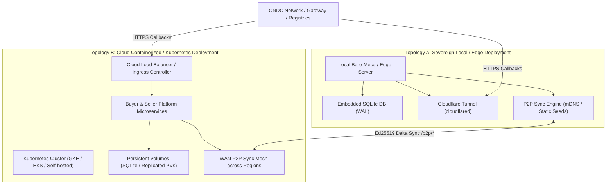

# ONDC Go DevOps & Operations Guide

## 1. Overview & Deployment Topologies

ONDC Go is designed to support two primary deployment models:



- **Topology A (Sovereign Local Node):** Ideal for edge participants, regional retail centers, and self-hosted environments. Uses Cloudflare Tunnel (`cloudflared`) for secure ingress without public static IPs, combined with embedded pure-Go SQLite and local P2P synchronization.
- **Topology B (Cloud Containerized / Kubernetes):** Ideal for high-throughput enterprise participant deployments. Uses Bazel container images, Terraform infrastructure modules, and horizontal pod autoscaling.

---

## 2. Building & Containerization

### 2.1. Native Go Toolchain

For local builds and lightweight container images:

```bash
# Verify Go version (Go 1.20+ required)
go version

# Download dependencies
go mod download

# Build all binaries
go build ./...
```

### 2.2. Hermetic Container Builds with Bazel

The repository uses Bazel (`MODULE.bazel`, `WORKSPACE`) to produce reproducible, hermetic OCI container images.

Helper scripts are provided in [`/docker/scripts`](/docker/scripts):

```bash
# Build and publish all service images to your container registry
./docker/scripts/publish_all.sh <REGISTRY_HOST> <REPOSITORY_PATH>

# Example: Publishing to Google Artifact Registry
./docker/scripts/publish_all.sh "asia-southeast1-docker.pkg.dev" "my-project-id/ondc-go"
```

Individual service publish scripts:

- [`/docker/scripts/publish_buyer.sh`](/docker/scripts/publish_buyer.sh): Buyer app, BAP adapter, BAP APIs, request action.
- [`/docker/scripts/publish_seller.sh`](/docker/scripts/publish_seller.sh): BPP API, callback action, seller adapter.
- [`/docker/scripts/publish_onboarding.sh`](/docker/scripts/publish_onboarding.sh): Registration and site verification service.
- [`/docker/scripts/publish_keyrotation.sh`](/docker/scripts/publish_keyrotation.sh): Cryptographic key management service.
- [`/docker/scripts/publish_mockup.sh`](/docker/scripts/publish_mockup.sh): Gateway, seller, and registry mockups for sandbox testing.

---

## 3. Sovereign Local Ingress via Cloudflare Tunnel

To receive incoming ONDC network callbacks (`/on_*`, `/search`, `/init`) and serve the mandatory `/ondc-site-verification.html` file without exposing public static IPs or opening firewall ports, use Cloudflare Tunnel.

### 3.1. Prerequisites

- `cloudflared` binary installed (`cloudflared --version`).
- A Cloudflare account with a managed domain (e.g. `example.com`).

### 3.2. Tunnel Automation Script

Use [`/scripts/run_local_tunnel.sh`](/scripts/run_local_tunnel.sh) to generate configurations and launch the tunnel:

```bash
# 1. Check required dependencies
./scripts/run_local_tunnel.sh check-deps

# 2. Export environment variables matching your deployment
export TUNNEL_ID="your-tunnel-uuid"
export TUNNEL_HOSTNAME="ondc.yourdomain.com"
export CREDENTIALS_FILE="$HOME/.cloudflared/${TUNNEL_ID}.json"
export ONBOARDING_PORT=8080
export BAP_PORT=8081
export BPP_PORT=8082

# 3. Generate the ingress configuration from template
./scripts/run_local_tunnel.sh generate-config

# 4. Validate ingress routing rules
./scripts/run_local_tunnel.sh validate-config

# 5. Launch the tunnel
./scripts/run_local_tunnel.sh run-tunnel
```

### 3.3. Ingress Routing Table

The generated configuration routes traffic based on ONDC path conventions:

| Path Prefix | Target Service | Local Port |
| :--- | :--- | :--- |
| `/ondc-site-verification.html` | Onboarding Service | `http://localhost:8080` |
| `/on_subscribe` | Onboarding Service | `http://localhost:8080` |
| `/bap/*` | Buyer BAP API | `http://localhost:8081` |
| `/bpp/*` | Seller BPP API | `http://localhost:8082` |
| `/*` (Fallback) | Default catch-all (404) | Built-in HTTP 404 rule |

---

## 4. Storage & Decentralized P2P Mesh Operations

### 4.1. SQLite Storage Configuration

The embedded storage layer ([`/shared/storage`](/shared/storage)) uses `modernc.org/sqlite` without CGO.

**Operational Best Practices:**

- **WAL Mode:** Write-Ahead Logging (`PRAGMA journal_mode = WAL;`) and synchronous normal (`PRAGMA synchronous = NORMAL;`) are enabled by default for concurrent read/write throughput.
- **Directory Permissions:** Ensure the directory containing the SQLite `.db` file is writable by the process user (needed for `.db-wal` and `.db-shm` temporary files).
- **Backups:** Use the SQLite online backup API or `VACUUM INTO 'backup.db'` during production snapshots.

### 4.2. P2P Peer Discovery Setup

The discovery engine ([`/shared/p2p/discovery.go`](/shared/p2p/discovery.go)) operates in hybrid mode:

1. **Local LAN Discovery (mDNS):**
   - Nodes on the same subnet announce service type `_ondc-p2p._tcp` over multicast UDP port 5353.
   - Automatically discovers peer IP and port without manual configuration.

2. **Wide-Area Discovery (Bootstrap Seeds):**
   - For WAN or cross-cloud deployments, configure static seed URLs in your service environment:

     ```bash
     ONDC_P2P_STATIC_SEEDS="https://peer1.region-a.org:8080,https://peer2.region-b.org:8080"
     ```

   - The node actively probes seeds via authenticated `/p2p/ping` calls and registers responsive peers in the dynamic registry.

### 4.3. sqlite-p2p Runtime Interoperability Bridge Setup

When running in heterogeneous clusters where nodes interoperate with the [`sqlite-p2p`](https://github.com/innomon/sqlite-p2p) decentralized mesh, deploy the standalone bridge daemon ([`cmd/ondc-p2p-bridge`](/cmd/ondc-p2p-bridge)):

1. **Configuration Precedence (CLI Flags > Environment Variables > Defaults):**

   | Parameter | CLI Flag | Environment Variable | Default |
   | :--- | :--- | :--- | :--- |
   | Primary ONDC DB | `--db-path` | `ONDC_SQLITE_DB_PATH` | `./data/ondc.db` |
   | sqlite-p2p DB | `--crm-path` | `ONDC_SQLITE_P2P_CRM_PATH` | `./data/sqlite_p2p_crm.db` |
   | Node Identifier | `--node-id` | `ONDC_NODE_ID` | `node-<hostname>` |
   | Sync Interval | `--sync-interval` | `ONDC_P2P_SYNC_INTERVAL` | `2s` |
   | Max Batch Size | `--max-batch-size` | `ONDC_P2P_MAX_BATCH_SIZE` | `500` |
   | HTTP Telemetry | `--http-addr` | `ONDC_BRIDGE_HTTP_ADDR` | `:8085` |

2. **Running as a Systemd Service:**
   ```ini
   [Unit]
   Description=ONDC to sqlite-p2p Auto-Replication Bridge Daemon
   After=network.target

   [Service]
   Type=simple
   User=ondc
   ExecStart=/usr/local/bin/ondc-p2p-bridge \
       --db-path=/var/data/ondc/ondc.db \
       --crm-path=/var/data/ondc/sqlite_p2p_crm.db \
       --sync-interval=2s \
       --http-addr=:8085
   Restart=always
   RestartSec=5s

   [Install]
   WantedBy=multi-user.target
   ```

3. **Running in Docker:**
   ```bash
   docker run -d \
       --name ondc-p2p-bridge \
       -v /host/data:/data \
       -e ONDC_SQLITE_DB_PATH="/data/ondc.db" \
       -e ONDC_SQLITE_P2P_CRM_PATH="/data/sqlite_p2p_crm.db" \
       -p 8085:8085 \
       ghcr.io/innomon/ondc-p2p-bridge:latest
   ```

4. **Health Checks & Telemetry:**
   - **Liveness/Readiness Probe:** `curl http://localhost:8085/healthz` (returns `200 {"status":"ok"}`).
   - **Replication Metrics:** `curl http://localhost:8085/status` (returns JSON stats on exports, imports, Lamport clock, and sync errors).

### 4.4. Peer Mutual Authentication

All replication calls (`/p2p/push`, `/p2p/pull`, `/p2p/ping`) enforce cryptographic mutual authentication:

- Every request must include:
  - `X-ONDC-Peer-ID`: Node identifier.
  - `X-ONDC-Timestamp`: Unix timestamp (requests skewed beyond 300s are rejected).
  - `X-ONDC-Signature`: Ed25519 signature of `timestamp:method:path:body_hash`.
- Ensure public signing keys of approved peers are loaded into the peer registry or verified against the participant directory.

---

## 5. Cloud Infrastructure (Terraform & Kubernetes)

### 5.1. Terraform Modules

The [`/terraform`](/terraform) directory contains modules for provisioning enterprise cloud infrastructure:

- [`/terraform/modules/buyer`](/terraform/modules/buyer): Buyer cluster, VPC networking, GKE deployments.
- [`/terraform/modules/seller`](/terraform/modules/seller): Seller cluster, BPP adapter, callback dispatchers.
- [`/terraform/modules/onboarding`](/terraform/modules/onboarding): Onboarding service and site verification ingress.
- [`/terraform/modules/key-rotation`](/terraform/modules/key-rotation): Secret manager bindings and key rotation service.

### 5.2. Example Environment Deployment

To initialize and apply the sample Terraform topology:

```bash
cd terraform/examples/sample
terraform init
terraform plan -out=tfplan.binary
terraform apply tfplan.binary
```

### 5.3. Rolling Restarts on Kubernetes

To perform zero-downtime rolling updates of deployed pods:

```bash
# Restart Buyer Platform deployments
./scripts/restart_buyer_deployments.sh

# Restart Seller Platform deployments
./scripts/restart_seller_deployments.sh
```

---

## 6. Observability, Health Checks & Metrics

### 6.1. P2P Status Endpoint (`/p2p/status`)

Each node exposes an operational health and replication metric endpoint:

```bash
curl -s http://localhost:8080/p2p/status | jq .
```

**Sample Response:**

```json
{
  "node_id": "bap-node-01",
  "role": "bap",
  "clock": 142,
  "total_changes": 142,
  "active_peers": 3,
  "peers": [
    {
      "id": "bpp-node-01",
      "address": "http://10.0.1.15:8080",
      "role": "bpp",
      "state": "active",
      "latency_ms": 12
    },
    {
      "id": "gateway-node-01",
      "address": "http://10.0.2.20:8080",
      "role": "gateway",
      "state": "active",
      "latency_ms": 28
    }
  ]
}
```

### 6.2. Kubernetes Liveness & Readiness Probes

Configure container probes using standard HTTP endpoints:

```yaml
livenessProbe:
  httpGet:
    path: /p2p/ping
    port: 8080
  initialDelaySeconds: 5
  periodSeconds: 10

readinessProbe:
  httpGet:
    path: /p2p/status
    port: 8080
  initialDelaySeconds: 5
  periodSeconds: 10
```

---

## 7. CI/CD & Automated Verification

### 7.1. Automated Test Pipeline

Run automated quality gates prior to building images or cutting releases:

```bash
# 1. Run unit & integration tests with race detector
go test -v -race ./...

# 2. Run multi-node P2P mesh convergence test
go test -v -run TestP2PSyncE2E_MultiNodeMesh ./test/p2p_sync_e2e_test.go

# 3. Run Cloudflare Tunnel ingress test
go test -v -run TestLocalTunnel_GenerateAndValidate ./test/ingress_e2e_test.go

# 4. Check test coverage threshold (>80%)
go test -coverprofile=coverage.out ./shared/p2p/... ./shared/storage/...
go tool cover -func=coverage.out
```

### 7.2. Production Checklist

- [ ] Ed25519 signing keys and X25519 encryption keys securely generated and backed up.
- [ ] Public site verification file accessible at `https://<DOMAIN>/ondc-site-verification.html`.
- [ ] `/on_subscribe` endpoint reachable and returning valid ONDC registration signatures.
- [ ] Cloudflare Tunnel running as a systemd service or container daemon (`cloudflared service install`).
- [ ] SQLite database path mapped to persistent, high-IOPS storage with WAL mode enabled.
- [ ] Static bootstrap peer seeds configured for cross-cluster or multi-region P2P replication.
